> [!NOTE]
> **All seven build slices are implemented.** The app includes live plan reading, confirmation, the live checker, real scored AI suggestions, a fixed-choice change builder, Before/After comparison and a printable report. Gemini is primary, with Groq as fallback. The saved reading and suggestions are real, unedited provider output; the example needs no key. The screenshots and sample PDF below come from the actual example flow. The learner's final hands-on review, learning wrap-up, video and submission answers remain separate completion steps.

<div align="center">

# Failure Compiler

**Crash-test a plan before Saturday does.**

AI reads a messy plan. A strict checker tries every single problem and every pair of problems against it.<br/>
Fixes get tested before you trust them.

[](LICENSE)
[](pyproject.toml)
[](https://developers.google.com/optimization/cp/cp_solver)
[](devpost/)
[](#run-it-locally)

**[Demo video status](#demo-video)** &nbsp;·&nbsp; **[Run it locally](#run-it-locally)** &nbsp;·&nbsp; **[Read the planning docs](#built-plan-first)**

[](#demo-video)

</div>

> [!TIP]
> **Judging in a hurry? Two minutes, five links.**
> 1. [Demo video status](#demo-video) (recording pending)
> 2. [The moment that matters](#the-moment) (a GIF: the obvious fix gets turned down, the real one flips the grid)
> 3. [A real report the app produced](docs/sample-report.pdf) (PDF)
> 4. [Spot the hidden pair yourself](#can-you-spot-it) (a 60-second puzzle)
> 5. [Check every claim with one command](#check-every-claim-yourself)

---

## Every job had a backup. The plan still broke.

A volunteer coordinator is running a Saturday food distribution: **30 households, 3 routes, 5 volunteers, one van, one car, one loading area, everything delivered by noon.** Every route has a driver and a backup. On paper, the plan is all ticks.

Then the van comes back from its early pickup 30 minutes late. On its own, that's fine. Anita has to leave 90 minutes early. On its own, also fine. **Both on the same morning, and 8 households get no food.**

Nobody checks combinations like that by hand, because there are too many of them. Failure Compiler checks all of them, shows you the exact morning that breaks, and tests whether a fix really works before you trust it.

| Most tools and chatbots | Failure Compiler |
|---|---|
| A list of general risks ("have a backup driver") | The specific combination that breaks *your* plan |
| "Infeasible" or a red bar | **"Route C: 8 households not delivered"**, with the morning drawn out |
| Fixes that sound right | Fixes scored against every scenario; the ones that fail are **turned down** |
| A confident answer either way | Three honest answers: *breaks*, *survived what we tested*, or *couldn't tell* |

---

## Can you spot it?

Here is the plan, written the way coordinators actually write plans. **Before you open the answer:** which two things going wrong would leave families without food?

```text
SAT FOOD RUN - plan for this weekend (pls read!!)

Hall opens 9am. Loading bay needs the hall key - Joel has the only key. Joel is here 9 till 10:30, then he has to go.
Supply truck drops at the bay at 9.
Van is out on the early bread pickup, back by 9:30. Car is free from 9.
Everything delivered by 12 noon latest, families are waiting.

Route A - 10 households - car - Ravi driving, about an hour. Backup: Maya, then Joel
Route B - 12 households - van, first run - Sam driving, about 35 min. Backup: Anita or Ravi
Route C - 8 households - van, second run once it's back - Anita driving, about an hour. Backup: Sam or Ravi

Loading takes about 10 min per vehicle, only one vehicle in the bay at a time.
Loading team: Joel, Anita, Maya. Ravi can load his own car. Sam is just driving, not on loading.

Times: Ravi around till 1. Anita and Sam till 12. Maya has to leave at 10:45.
Everyone can drive.
```

<details>
<summary><b>Show the answer</b> &nbsp;(the checker found 4 ways this plan breaks)</summary>
<br/>

| What goes wrong | What happens |
|---|---|
| **Joel doesn't show up** | **Routes A, B, C: 30 households not delivered.** Joel has the only key, so nobody can open the loading area. *This is the obvious one.* |
| **Supply truck 45 min late** + **Ravi doesn't show up** | **Route A: 10 households not delivered.** Loading can't start until 9:45, and Ravi's backups both leave before an hour-long route could finish: Joel at 10:30, Maya at 10:45. |
| **Van back 30 min late** + **Anita leaves 90 min early** | **Route C: 8 households not delivered.** The van finishes Route B at 10:45. Joel and Anita left at 10:30, and Maya leaves at 10:45. Nobody on Route C's loading list is left to load it. |
| **Van back 30 min late** + **Anita doesn't show up** | Same as above. If leaving early breaks the plan, not coming at all has to break it too. |

Every problem in the last three rows is **harmless on its own**. Each one only breaks the plan when it's paired with another. That's a **hidden pair**, and it's what this tool exists to find.

</details>

---

## How it works

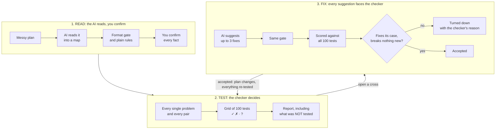

> [!IMPORTANT]
> **The one rule:** AI reads the plan and suggests fixes. The checker decides. AI never has the final word on whether a plan passes or fails.

1. **Paste a plan.** Or load the example. No AI key is needed for the example.
2. **Check the map.** The AI turns the text into plain statements like *"Maya leaves at 10:45"*. Source tags distinguish the AI's citation for a particular field, such as *"Loaders · L13"*, from an entity mention, such as *"Ravi · mentioned on L8"*. A mention does not support every fact about Ravi. Missing field citations stay missing; check the value against the plan. Guesses are flagged, and anything unclear becomes a question. You confirm or correct each fact, picking from names and times already in the plan; there's no free typing.
3. **Crash-test it.** The checker tries every single problem and every pair from a fixed list. The grid fills in live.
4. **Open a cross.** See the two problems, proof that each one alone was fine, the morning drawn on a timeline, and the human cost in households.
5. **Fix it.** Up to 3 AI cards, each already scored against all 100 tests. The ones that don't work are turned down, with the checker's reason. Or build your own change from up to three fixed-choice operations. Accepting either kind updates the plan and re-tests everything.
6. **Compare and report.** Before/After restores the original and current results from the accepted-fix chain. Open the report any time after the first run, even with crosses remaining. It includes confirmed facts, the exact tests, original breaks, accepted and turned-down changes, final results and what was **not** tested. Print it or save it as a PDF.

---

## What you see

Six real Playwright captures, each **1500 × 1000 (3:2)**, ready for the README and Devpost gallery. [Capture details and commands](docs/images/README.md).
<table>
<tr>
<td width="50%">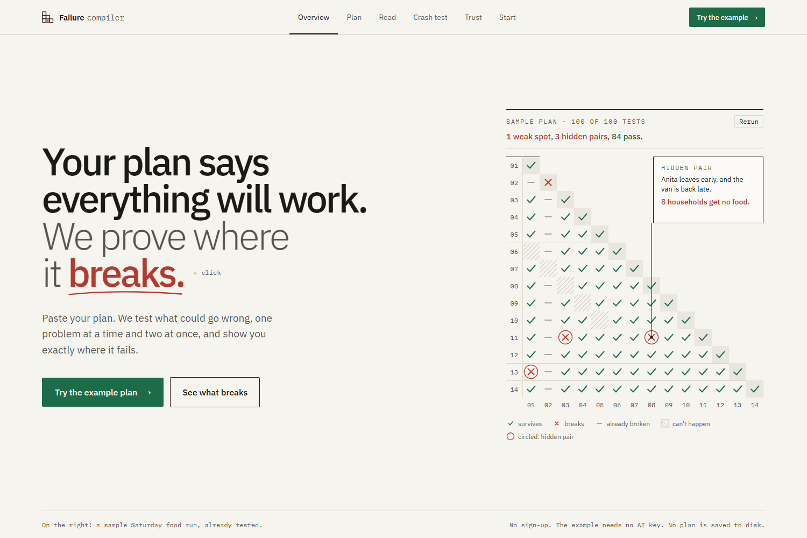<br/><b>1. The landing page.</b> Start with a plan or try the saved example.</td>
<td width="50%">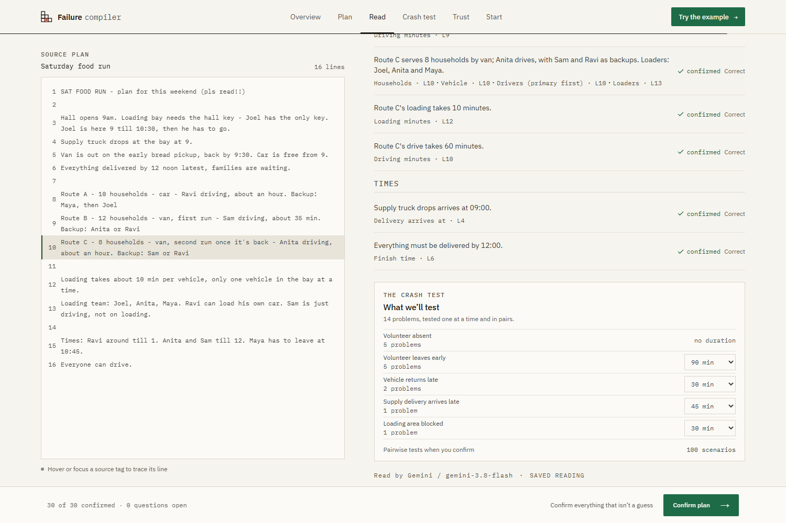<br/><b>2. The plan map.</b> Hover or focus a source tag to highlight its line. Field citations and entity mentions are labelled separately.</td>
</tr>
<tr>
<td>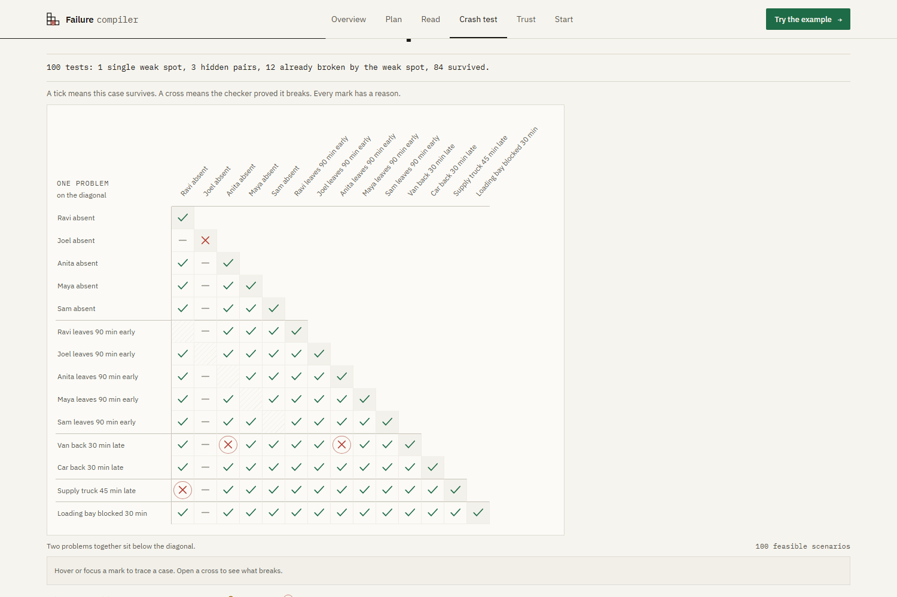<br/><b>3. The crash test.</b> 100 tests, one triangle, filling in live.</td>
<td>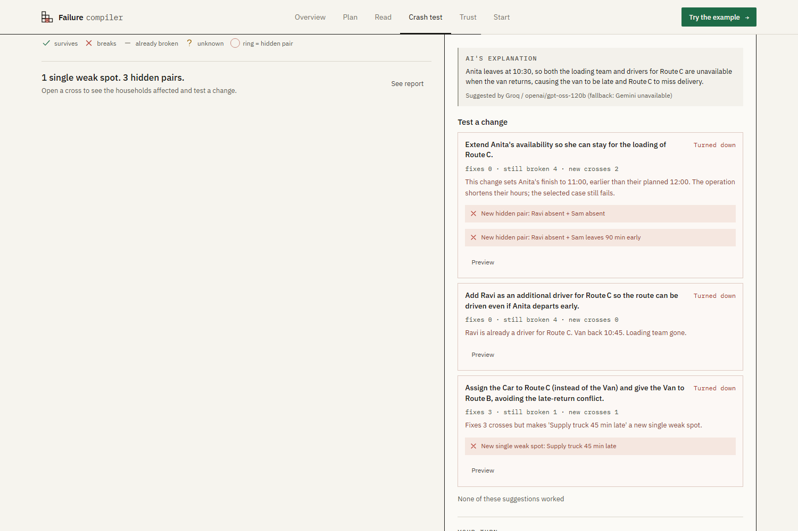<br/><b>4. Three real suggestions, turned down.</b> The checker shows why each fails.</td>
</tr>
<tr>
<td>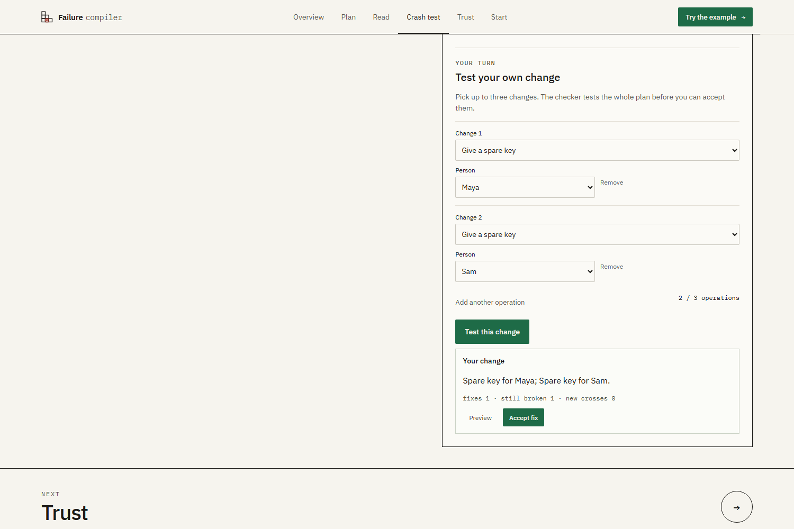<br/><b>5. Your change.</b> Two spare keys, tested against every scenario before acceptance.</td>
<td>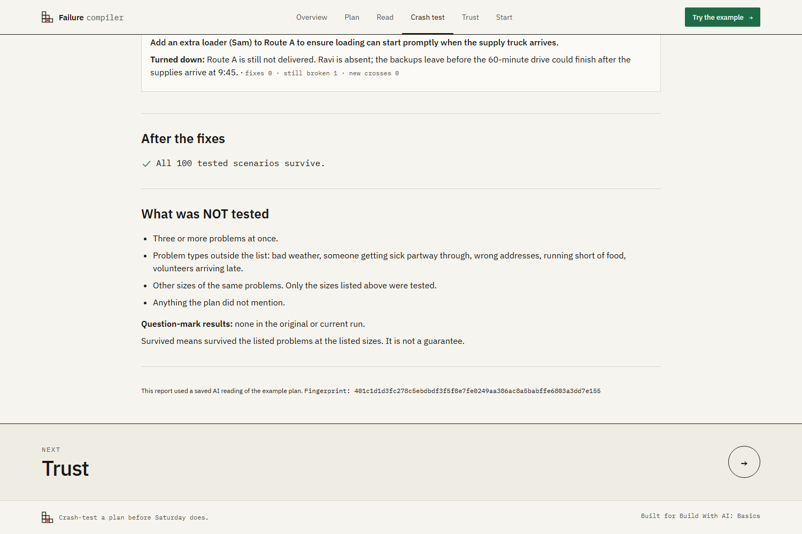<br/><b>6. The report.</b> Including an honest "What was NOT tested" section.</td>
</tr>
</table>

### The moment

Two actual Playwright frames, before and after accepting the real Sam loader card. Both van crosses flip; the remaining breaks stay visible.
<p align="center">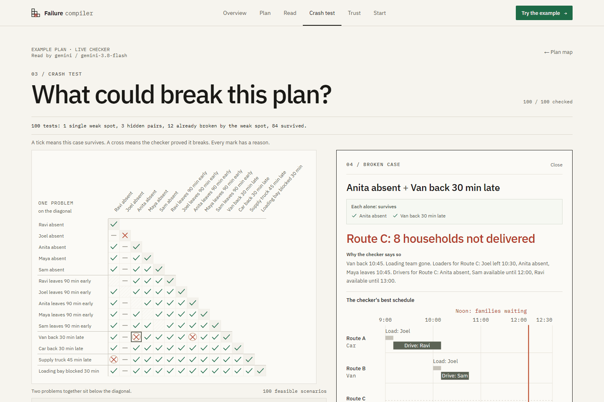</p>

### Demo video

**Video link: pending recording.** The gallery, before/after frames and [five-page sample report](docs/sample-report.pdf) are available now. The [2:30 click runbook](devpost/demo-runbook.md) uses a 1440x900 viewport at 100% zoom. Start each take at **http://127.0.0.1:5173/demo** when using the development launcher, or **http://127.0.0.1:8000/demo** when serving the built app. This clears only that browser's state and returns to the landing page.

Actual-app thumbnail candidates: [YouTube, 1280x720](docs/images/youtube-thumbnail.png) · [Devpost, 1500x1000](docs/images/devpost-thumbnail.png).

---

## The example, in numbers

> **100 tests: 1 single weak spot, 3 hidden pairs, 12 already broken by the weak spot, 84 survived.**

The checker turns a fixed list of problem types into concrete problems for the people, vehicles and places in your plan:

| Problem type | Applies to | Size tested | In the example |
|---|---|---|---|
| Doesn't show up | each volunteer | the whole morning | 5 |
| Leaves early | each volunteer | 90 minutes early | 5 |
| Comes back late | each vehicle | 30 minutes late | 2 (van, car) |
| Arrives late | each supply delivery | 45 minutes late | 1 (truck) |
| Blocked | each loading area | 30 minutes from opening | 1 |
| | | **Problems** | **14** |

Every single problem (14) plus every pair (86) gives **100 tests**. There are 91 possible pairs, but 5 can't happen, such as "Anita doesn't show up" plus "Anita leaves early", so they're skipped. You can change any size before testing, but only to a preset value (15, 30, 45, 60 or 90 minutes). This version supports plans with up to 24 problems.

<details>
<summary><b>See all 100 results</b> &nbsp;(the same triangle the app draws, generated from the checker's real output)</summary>
<br/>

`✓` survives &nbsp; `✗` breaks &nbsp; `·` already broken by "Joel absent" alone &nbsp; `/` can't happen (same person twice). The diagonal holds the single problems; every cell below it is a pair.

| # | Problem | 1 | 2 | 3 | 4 | 5 | 6 | 7 | 8 | 9 | 10 | 11 | 12 | 13 | 14 |
|---:|---|:-:|:-:|:-:|:-:|:-:|:-:|:-:|:-:|:-:|:-:|:-:|:-:|:-:|:-:|
| 1 | Ravi absent | ✓ |   |   |   |   |   |   |   |   |   |   |   |   |   |
| 2 | Joel absent | · | **✗** |   |   |   |   |   |   |   |   |   |   |   |   |
| 3 | Anita absent | ✓ | · | ✓ |   |   |   |   |   |   |   |   |   |   |   |
| 4 | Maya absent | ✓ | · | ✓ | ✓ |   |   |   |   |   |   |   |   |   |   |
| 5 | Sam absent | ✓ | · | ✓ | ✓ | ✓ |   |   |   |   |   |   |   |   |   |
| 6 | Ravi leaves early | / | · | ✓ | ✓ | ✓ | ✓ |   |   |   |   |   |   |   |   |
| 7 | Joel leaves early | ✓ | / | ✓ | ✓ | ✓ | ✓ | ✓ |   |   |   |   |   |   |   |
| 8 | Anita leaves early | ✓ | · | / | ✓ | ✓ | ✓ | ✓ | ✓ |   |   |   |   |   |   |
| 9 | Maya leaves early | ✓ | · | ✓ | / | ✓ | ✓ | ✓ | ✓ | ✓ |   |   |   |   |   |
| 10 | Sam leaves early | ✓ | · | ✓ | ✓ | / | ✓ | ✓ | ✓ | ✓ | ✓ |   |   |   |   |
| 11 | Van back late | ✓ | · | **✗** | ✓ | ✓ | ✓ | ✓ | **✗** | ✓ | ✓ | ✓ |   |   |   |
| 12 | Car back late | ✓ | · | ✓ | ✓ | ✓ | ✓ | ✓ | ✓ | ✓ | ✓ | ✓ | ✓ |   |   |
| 13 | Truck late | **✗** | · | ✓ | ✓ | ✓ | ✓ | ✓ | ✓ | ✓ | ✓ | ✓ | ✓ | ✓ |   |
| 14 | Loading area blocked | ✓ | · | ✓ | ✓ | ✓ | ✓ | ✓ | ✓ | ✓ | ✓ | ✓ | ✓ | ✓ | ✓ |

Notice row 7: "Joel leaves early" survives. He's there at 9:00 to unlock the hall before he goes, and the hall stays open once it's unlocked. "Joel absent" is a different story.

</details>

---

## The broken morning

Van back 30 minutes late **and** Anita leaves 90 minutes early. Route C can only be loaded by Joel, Anita or Maya. Look at where their bars end, and when the van gets back.

```mermaid
gantt
    title Van back 30 min late and Anita leaves 90 min early
    dateFormat HH:mm
    axisFormat %H:%M
    section Van
    Early bread pickup, back 30 min late :done, v1, 09:00, 60m
    Route B, loaded by Joel, driven by Sam :v2, 10:00, 45m
    section Loaders
    Joel, the only key holder :j, 09:00, 90m
    Anita, leaves 90 min early :crit, a, 09:00, 90m
    Maya :m, 09:00, 105m
    section Route C
    Van is back. Nobody left to load. 8 households not delivered :crit, milestone, c, 10:45, 1m
    section Deadline
    Noon. Families waiting :milestone, noon, 12:00, 1m
```

**Each problem alone is fine:**
- **Van late only:** Anita is still there at 10:45 and loads Route C.
- **Anita leaving only:** the on-time van is back from Route B by 10:15, while Anita and Maya are still there to load Route C.

**Together:** the van is free at the exact moment the last loader walks out.

### What the real suggestions did

| Case / suggested change (short label) | Checker's verdict on the original map | Why |
|---|---|---|
| Van + Anita early: extend Anita | **✗ Turned down.** Fixes 0, 2 new crosses. | Description says extend, but the operation sets her finish to 11:00, earlier than her planned 12:00. |
| Van + Anita early: add Ravi as driver for C | **✗ Turned down.** Fixes 0, 0 new crosses. | Ravi is already a driver for C. Loading still fails when the van is back at 10:45. |
| Van + Anita early: C to car, B to van | **✗ Turned down.** Fixes 3, 1 new cross. | Makes "Supply truck 45 min late" a new single weak spot. |
| Van + Anita absent: replace C's drivers | **✗ Turned down.** Fixes 0, 2 new crosses. | Still no loader; replacing drivers also creates problems elsewhere. |
| Van + Anita absent: **add Sam as loader for C** | **✓ Eligible. Fixes 2, 0 new crosses.** | Sam can load after the original loading team leaves. Both van crosses flip. |
| Van + Anita absent: assign van earlier / car to B | **Couldn't apply.** Not scored. | Operation targets are vehicle IDs where route IDs are required. |
| Joel absent: spare key for Ravi | **✗ Turned down.** Fixes 1, 1 new cross. | Creates the hidden pair "Joel absent + Ravi absent". |
| Joel absent: replace A's drivers | **✗ Turned down.** Fixes 0, 2 new crosses. | Nobody can open the loading area; replacing drivers creates other breaks. |
| Joel absent: replace loaders | **✗ Turned down.** Fixes 0, 2 new crosses. | Still no key; changes elsewhere create more broken pairs. |
| Truck + Ravi: replace A's drivers | **✗ Turned down.** Fixes 1, 9 new crosses. | Fixes this case but removing the planned driver creates new broken pairs. |
| Truck + Ravi: spare key for Anita | **✗ Turned down.** Fixes 1, 1 new cross. | Fixes Joel's single instead; the selected truck case stays broken. |
| Truck + Ravi: add Sam as loader for A | **✗ Turned down.** Fixes 0, 0 new crosses. | The gap here is driving, not loading. |

**12 real cards: 10 turned down after scoring, 1 rejected by the gate, 1 eligible.** Descriptions, operations, provider metadata and Gemini's 503/504 history are preserved in [`fixtures/example-fixes.json`](fixtures/example-fixes.json). The app shows the full, unedited descriptions with the label **Suggested by Groq / openai/gpt-oss-120b (fallback: Gemini unavailable)**. Each card is gated and scored live against the current map; reopening uses the cache. No second round was captured.

**The demo story:**

1. Open van + Anita leaves early: all three AI cards are turned down. Previewing one never changes the plan.
2. Open van + Anita absent. Accept **"Add an extra loader (Sam) to Route C so loading can finish after the original loaders leave."** Both van crosses flip. History: **Fix 1 (AI)**.
3. Open Joel absent. The AI's one-key card reveals Joel + Ravi absent. Under **Test your own change**, pick spare keys for **Maya and Sam**, then **Test this change**. It fixes Joel, creates no new crosses and makes every re-tested Joel pair survive. Accept: **Fix 2 (yours)**.
4. Open truck + Ravi. Build **Sam as another driver for Route A**, test and accept: **Fix 3 (yours)**.
5. **All 100 tested scenarios survive.**

The builder uses picks only: add a driver or loader, give a spare key, change someone's hours with a time picker, or move a route to another vehicle. Up to three operations use the same gate, preview and acceptance rules as the AI. When no AI card is eligible, the app says **"None of these suggestions worked"**. Live mode with a key offers **"Ask for new suggestions"** once; saved example mode does not call a provider.

```mermaid
gantt
    title The same morning with one fix. Sam loads Route C
    dateFormat HH:mm
    axisFormat %H:%M
    section Van
    Early bread pickup, back 30 min late :done, 09:00, 60m
    Route B, loaded by Maya, driven by Sam :10:00, 45m
    Route C loaded by Sam :active, 10:45, 10m
    Route C driven by Ravi :active, 10:55, 60m
    section Deadline
    Noon. Families waiting :milestone, 12:00, 1m
```

Route C is back at 11:55. That's inside the deadline by 5 minutes, and that's all the tool claims: **it survives the problems that were tested.** If you want a bigger margin, a minimum-buffer setting is on the [roadmap](#roadmap).

<details>
<summary><b>Try it yourself: change one number</b></summary>
<br/>

Predict first: **what happens if Maya stays 10 minutes longer, until 10:55?**

```bash
cp fixtures/example-truth.json my-plan.json
# In my-plan.json, change Maya's "available_until" from 645 (10:45) to 655 (10:55)
uv run -- python scripts/check_map.py my-plan.json
```

<details>
<summary>Answer</summary>
<br/>

**All three hidden pairs disappear.** Only "Joel absent" is left. Ten minutes of one volunteer's morning is the difference between 3 hidden failures and none, and no person could see that by reading the plan. At 10:50 the pairs come back.

</details>
</details>

---

## Where AI is used, and where it isn't

This is the planned live-AI flow for slice 6. The current example mode makes no AI calls.

| AI does | AI never does |
|---|---|
| Reads the messy plan into a structured map | Decide whether the plan passes or fails |
| Flags its guesses and asks about anything unclear | Choose which problems get tested |
| Writes one plain sentence explaining a break, clearly labelled | Write the reason a fix was turned down |
| Suggests up to 3 fixes, from a fixed list of allowed changes | Invent new people or vehicles |

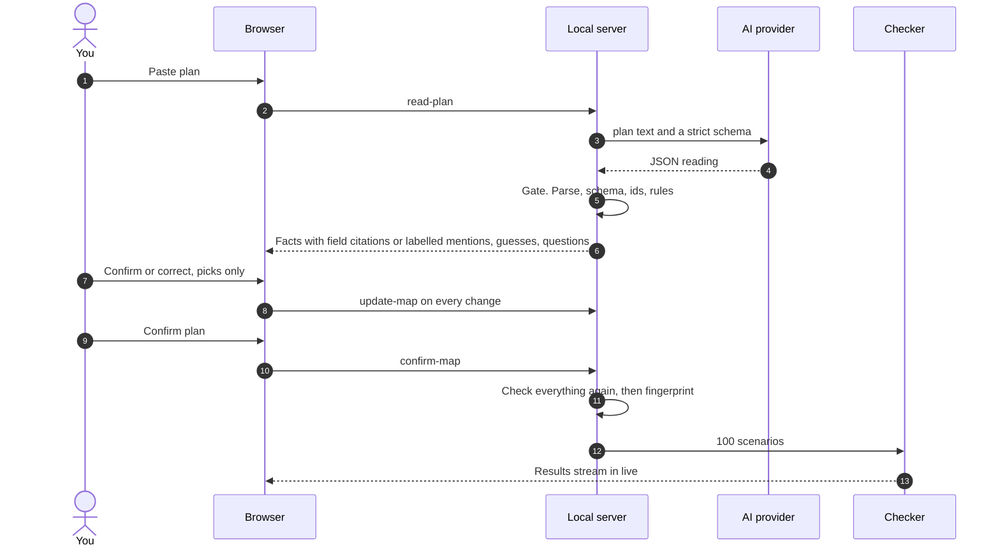

**The gate.** Nothing the AI returns reaches the screen until it passes every step:
1. It parses as JSON.
2. It matches the schema exactly. Required fields and types are checked and extra fields are rejected ([Pydantic](https://docs.pydantic.dev/latest/), `extra="forbid"`). New provider schemas require every nullable field citation; replaying an older capture without per-field sources supplies nulls, never invented evidence.
3. No duplicate ids, and every reference points to something that exists.
4. Ids and references are normalised (`person-ravi`, `vehicle-van`, `route-a`), without doubling type words. Display names are labels; the fingerprint uses canonical checker inputs.
5. Plain rules pass: every route has a vehicle and a listed driver who can drive, the times make sense, there's a finish time, and the plan is under the size limit.
6. You confirm every fact. Guesses and questions need their own answer.
7. The server checks the whole map again on Confirm, and the checker refuses any map that fails.

Rejections name the problem, for example: *Unknown person id 'person-dave' in route-c driver_ids.* Suggested fixes go through the same gate. A fix that fails shows **Couldn't apply** and is never scored. Wrong-kind targets have a plain reason, such as *it named the van where a route was needed*, with the technical detail underneath.

**Every fact has a status, and changes ripple through.**

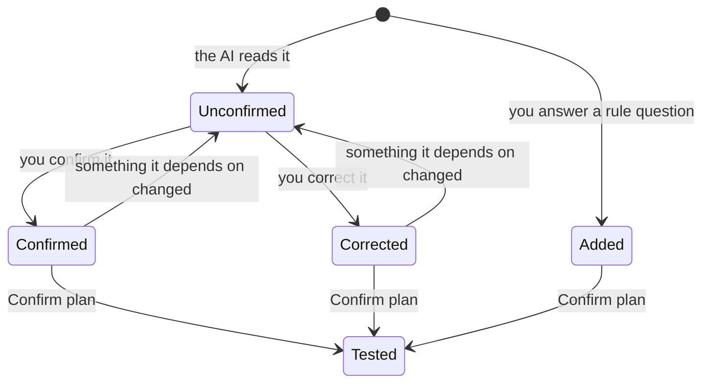

If you correct Ravi to "can't drive", every route that lists him as a driver loses its confirmed mark and shows *Check this: Ravi changed*. The AI never re-reads your plan after you start correcting it, because a re-read could quietly change facts you already confirmed.

**The fingerprint.** A confirmed map gets a SHA-256 fingerprint of exactly what the checker uses: people, vehicles, places, deliveries, routes, finish time and problem sizes. The same plan always gets the same fingerprint. Status marks and AI details don't change it. Every result carries it, and the report prints it in the footer.

---

## How the checker decides

Each test is one run of [Google OR-Tools CP-SAT](https://developers.google.com/optimization/cp/cp_solver), a free, open-source constraint solver. It searches for the best possible morning, the one with the least **households × minutes late**, using only what your plan allows.

**Natural schedules:** once the best lateness is proved, a second pass holds it fixed and minimises the sum of load and drive start times. Timelines show the earliest sensible morning without changing the verdict. A timeout in this display pass keeps the already-proved verdict.

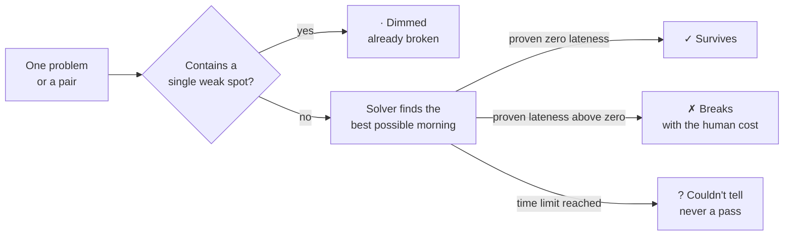

**What it models**
- A volunteer has an available-from and available-until time, and can't be in two places at once.
- A vehicle does one route at a time. It's busy from the start of loading until the route ends.
- The loading area takes one vehicle at a time. It opens at its opening time, once the supply truck is there and a key holder has arrived.
- Each route needs a listed loader present while loading, then a listed driver and its vehicle.
- **Only the people the plan names for a job can do that job.** Drivers are displayed primary first, then listed backups; loaders are an eligible set with no priority. Start times can move freely within everyone's hours. That's what makes "add another backup driver" a real fix that can be tested, and turned down.
- Noon is a soft deadline, so lateness can be measured instead of just failing.

**Why "not delivered" instead of "infeasible".** Some routes can't run at all, for example when nobody can open the loading area. Those routes count as "not delivered", with a penalty bigger than any possible lateness: households × (finish time + 180 minutes). So the solver always returns an answer, and the screen can say "8 households not delivered" instead of "no solution". The checker only reports a route as *late* when something becomes free later. When nobody is left to do the job, it says *not delivered*.

**Why dimming is safe.** Every problem type only *removes* options. A pair can never do better than its worse single, so a pair that contains a single weak spot is already broken, and there's no need to solve it. A test checks this on every pair. When a fix removes the weak spot, its dimmed pairs get tested properly again, and they can reveal a hidden pair. That's how the one-spare-key fix gets caught.

**Why the results never change.** The solver uses one worker, a fixed seed (42), and a *deterministic* time limit that counts solver work instead of seconds, so a slower laptop gets the same answer. The locked example test checks all 100 verdicts; the determinism test compares complete repeated results.

---

## What it does not claim

> [!WARNING]
> **Survived means survived what was tested, not "safe".** Failure Compiler only knows what's in the confirmed map, and only tests the fixed list of problems above. It does not test:
> - three or more problems at once
> - problem types outside the list: bad weather, someone getting sick halfway through, wrong addresses, running short of food, volunteers arriving late
> - other sizes of the same problems (the truck was tested 45 minutes late, not 90)
> - anything the plan didn't mention
>
> Any "?" result is listed by name in the report and never counted as a pass. This version supports community distribution plans with up to 24 problems. It is a proof of concept, not a guarantee for real-world operations.

> [!NOTE]
> **Saved example:** one unedited Gemini `read-v4` response has 39 reviewed field citations and 10 null citations. Missing evidence stays a labelled entity mention. The review controls identify Hall as the same place as Loading bay. Loader order needs no correction: eligible loaders are compared as a set. A regression verifies every checker input and all 100 locked verdicts against the independent hand-checked truth map. The approved saved suggestions are real Groq fallback responses, scored live; coordinator-built changes use the same gate and scorer. [Source and capture review](devpost/source-line-review.md).

---

## Check every claim yourself

Every number in this README can be reproduced from the repository.

Verified on 20 October 2026: **219 passed, 2 opt-in network tests skipped**. Ruff and the production build pass. The test run reports one Starlette/httpx dependency deprecation warning.

| Claim | How to check it |
|---|---|
| 1 single weak spot, 3 hidden pairs, 12 dimmed, 84 survived | `uv run -- python scripts/check_map.py fixtures/example-truth.json` |
| All 100 results are locked, human-cost wording included | [`tests/test_example_locked.py`](tests/test_example_locked.py) |
| The obvious fix fails, the real fixes pass, one spare key reveals a new pair | [`tests/test_example_fixes.py`](tests/test_example_fixes.py) |
| A pair is never better than its singles, which is why dimming is safe | [`tests/test_checker_monotone.py`](tests/test_checker_monotone.py) |
| Same map, same results, every run | [`tests/test_determinism.py`](tests/test_determinism.py) |
| Bad AI output is rejected, and the error names the field | [`tests/test_format_gate.py`](tests/test_format_gate.py) |
| Changing one fact un-confirms everything that depends on it | [`tests/test_rules.py`](tests/test_rules.py) |
| The fingerprint changes only when the checker's inputs change | [`tests/test_fingerprint.py`](tests/test_fingerprint.py) |
| The whole demo story plays end to end in a real browser | `uv run -- python scripts/verify_browser.py --story`, using an isolated offline server |
| V2 navigation, animation recovery, every sample square, editor controls and responsive layouts work | [`scripts/verify_landing.py`](scripts/verify_landing.py), at desktop, tablet and phone sizes |
| The saved AI reading plus the demo's corrections equals the hand-checked map | [`tests/test_reading_matches_truth.py`](tests/test_reading_matches_truth.py) |
| Live paste, review, checker, suggestions and apply work offline; keys and caches stay session-scoped | [`tests/test_live_api.py`](tests/test_live_api.py), recorded real reading and all four approved real suggestion responses |
| Coordinator picks pass the same gate; real-card story reaches all 100 survived | [`tests/test_change_builder.py`](tests/test_change_builder.py), [`tests/test_fix_pipeline.py`](tests/test_fix_pipeline.py), [`scripts/verify_story.py`](scripts/verify_story.py) |
| Provider read/connect timeouts become safe retryable errors | [`tests/test_live_transport.py`](tests/test_live_transport.py) |
| Real provider smoke tests require explicit opt-in and a key | [`tests/test_live_network.py`](tests/test_live_network.py) |
| Every saved field citation is in range, non-blank and reviewed for support | [`tests/test_example_reading_sources.py`](tests/test_example_reading_sources.py), [`tests/test_fact_sources.py`](tests/test_fact_sources.py), [`devpost/source-line-review.md`](devpost/source-line-review.md) |
| A clean take resets only this browser and rejects late stale requests | [`tests/test_demo_reset.py`](tests/test_demo_reset.py) |
| Reports preserve original breaks, actual review answers, scored fixes and final counts | [`tests/test_report.py`](tests/test_report.py), [`tests/test_fix_pipeline.py`](tests/test_fix_pipeline.py) |

Run the complete local verification after installation:

```bash
uv run -- python -m pytest -q
uv run -- ruff check .
npm run build
uv run -- python -m playwright install chromium
uv run -- python scripts/verify_browser.py
uv run -- python scripts/check_map.py fixtures/example-truth.json
```

The browser runner starts and stops its own isolated local server, blocks provider calls, and runs the saved story, review/editing regression, landing interactions and accessibility pass. Use `--story` for only the full example story. Accessibility checks cover keyboard operation, visible focus, reduced motion, text contrast of at least 4.5:1 and text at least 12px.

The ordinary test run makes no provider requests, even when `.env` contains keys. Offline end-to-end coverage replays the real saved reading and all four approved Groq suggestion responses through HTTP, including simulated Gemini 503 fallback, scoring and any eligible acceptance. `RECORDED_AI_FIXES_PATH` optionally selects another local recorder file. A separate explicitly synthetic response tests failure handling. Only the two opt-in real-network reading tests skip by default.

Real-network smoke tests run only when you explicitly set `RUN_LIVE_AI_TESTS=1` and a provider key is available. Without both, they skip. These tests send the fictional example plan to the provider.

---

## Run it locally

You need [uv](https://docs.astral.sh/uv/), which installs Python 3.12 for you, and Node.js 20 or newer.

The repository is currently private pending final publication approval, so cloning requires access. Setup below was verified in a fresh Windows clone without an `.env` file; download and cold-start time varies.

```bash
git clone https://github.com/vighriday/failure-compiler.git
cd failure-compiler
uv sync
npm install
uv run -- python scripts/dev.py
```

Open **http://127.0.0.1:5173** and click **Try the example plan**, then **Read plan**. Or open **Start** and click **Load the example plan**. No account and no AI key needed. `uv sync` includes the AI SDKs and the Python test/browser tools; install Chromium separately using the verification command above.

For the saved reading, answer the Hall question with **Same place as another listing**, choose **Loading bay**, and review its facts individually. Confirm guesses individually, answer the arrival questions after reviewing the associated facts, then confirm the plan. These steps produce the locked 100-scenario example.

The launcher waits for the API health check and web page before printing both addresses. It allows up to 90 seconds for a cold start and names any server still starting. Keep that terminal open; press `Ctrl+C` to stop both servers. If a port is already in use, it stops without launching a duplicate.

The interface follows the supplied Landing v2 design: Overview, a scroll-linked Plan story, Read, Crash test, Trust and Start. Sample illustrations are labelled; after loading a plan, Read and Crash test use the real confirmation and checker flow. The design templates and conversion instructions are in [`design/landing-v2/`](design/landing-v2/).

### Read your own plan

1. Copy `.env.example` to `.env` in the project folder. Add a [Gemini key](https://aistudio.google.com/apikey) as `GEMINI_API_KEY`; add a [Groq key](https://console.groq.com/keys) as `GROQ_API_KEY` to enable fallback. The server reads these keys when handling a live request.
2. Open **Start** and paste your plan. Or expand **Use your own AI key**, choose its provider and enter a key for this session. A typed key takes precedence for that provider; the selected provider is tried first. With environment keys, Gemini is tried first and Groq is the fallback.
3. Click **Read plan**, check the facts and their labelled field citations or entity mentions, and answer every guess and question. Confirm the map, run its tests and open a cross to request live suggestions. Every suggestion passes the format/rules gate and is checked across the full scenario grid before it can be accepted.

Typed keys stay only in the local server's session memory. They are never written to files, logged, added to a map or returned in an API response. The server sends an HttpOnly session cookie; that cookie contains no key. Closing a tab does not clear server memory. Opening `/demo` clears that browser's typed keys, reviews, maps, results and fixes, rotates its cookie, clears browser storage and returns to the landing page; other browsers are unaffected. Restarting the server clears all sessions. `.env` keys remain in your local ignored file.

The plan map and results show **Read by provider / model**; live suggestions show who supplied them. A Gemini server error such as HTTP 503, timeout, rate limit or failed output format check triggers one Groq attempt when a Groq key is available. Missing or invalid keys, unsupported plans and both-provider failures have clear errors and retry/example actions. A failed suggestion request leaves the checker's facts available.

Screen 1 shows the Gemini data notice: Google may use content to improve its products. Avoid personal details; the example plan is fictional. Loading the saved reading and real saved suggestions makes no AI calls. Requesting new suggestions in live mode uses a configured key and sends the confirmed map and selected case to the provider.

| Task | Command |
|---|---|
| Run the app | `uv run -- python scripts/dev.py` |
| Run all tests | `uv run -- python -m pytest -q` |
| Print the results for any map file | `uv run -- python scripts/check_map.py fixtures/example-truth.json` |
| Lint | `uv run -- ruff check .` |
| Browser checks, isolated and offline | `uv run -- python scripts/verify_browser.py` |
| Re-score saved provider readings without API calls | `uv run -- python scripts/bakeoff.py --rescore devpost/bakeoff-read-v4.json --output devpost/bakeoff-read-v4.json` |
| Run a fresh three-call-per-provider bake-off | `uv run -- python scripts/bakeoff.py` *(uses keys and makes API calls)* |

Playwright is included by `uv sync`. Install its browser once with `uv run -- python -m playwright install chromium`, build with `npm run build`, then run the isolated browser runner. The story, review and landing scripts can also target an already-running app through `FAILURE_COMPILER_URL`.

### Provider measurements

Checker equivalence compares **state, lateness_minutes and human_cost** for the same 100 scenarios. It excludes timelines, because equally good schedules can differ. Field matching aligns entities by type and role, ignores names, compares loaders as sets and keeps drivers in primary-first order. Complete campaigns rank by verdict matches, then aligned fields, consistency across runs, then tokens.

| Campaign / provider | Verdict matches across three slots | Aligned fields on successful runs | Successful runs |
|---|---|---|---|
| read-v3 / Gemini | 100, 100, 100 | 94.34%, 94.34%, 94.34% | 3/3 |
| read-v3 / Groq | 55, 55, 55 | 84%, 84%, 84% | 3/3 |
| read-v4 / Gemini | Timeout, HTTP 504, 100 | 94.34% | 1/3 |
| read-v4 / Groq | 12, HTTP 400, timeout | 88% | 1/3 |

Gemini remains primary from the last complete campaign, dated 19 October 2026. The new source-schema campaign is incomplete for both providers, so it establishes no new winner or consistency claim. Its one unedited successful Gemini response became the example after the existing UI controls brought it to **100% aligned fields and 100/100 verdicts**. [Capture and source review](devpost/source-line-review.md) · [Full measurement history](devpost/ai-reading-review.md).

---

## Built plan-first

This project was built with the **[Devpost Learn Skill Pack](https://github.com/challengepost/learn-ai-basics)** for [Build With AI: Basics](https://learn-ai-basics.devpost.com/). Every planning document the skills produced is in [`devpost/`](devpost/), next to an HTML version with diagrams.

| Skill | What it does | What it produced here |
|---|---|---|
| `1-start` | Learns the idea, your experience and your learning goal | A private learner profile (kept out of the repo) |
| `2-scope` | Finds the kernel, defines "done", cuts the idea down | [`scope.md`](devpost/scope.md) · [visual](devpost/scope.html) |
| `3-prd` | Screens, behaviour, edge cases, look and feel. No code talk. | [`prd.md`](devpost/prd.md) · [visual](devpost/prd.html) |
| `4-spec` | Stack, data, components, risks | [`spec.md`](devpost/spec.md) · [visual](devpost/spec.html) |
| `5-build` | Small working slices, each tested and committed | [`checklist.md`](devpost/checklist.md); the app map is planned for the learning wrap-up |
| `6-ship` | Repo, video, submission | Planned after the build and review are complete |

**The scope, PRD and spec were approved before implementation.** Later decisions and revisions are recorded in the checklist and individual commits. Run `git log --oneline --reverse` to see the trail:

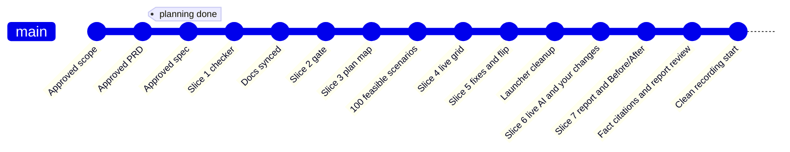

**What planning caught before it became code:**

| Caught at | What was wrong | What would have shipped |
|---|---|---|
| Scope review | One weak spot would fill a whole row and column of the grid with crosses | A wall of red hiding the hidden pairs. Fixed with the dimmed mark. |
| PRD interview | "How late is late" was read as a tolerance on the deadline | A meaningless setting. It means the size of each problem. |
| PRD review | The grid showed every pair twice | Wrong counts on the main visual. Fixed with one triangle. |
| Spec review | The AI's schema included fields only the server should own | An AI forced to invent a fingerprint and a fix history |
| Spec review | No rule for who may do which job | "Add a backup driver" could never be tested or turned down |
| Spec review | No key holder meant "no solution", not a number | The main weak spot with no human cost. Fixed with "not delivered". |
| Build checklist | "Give the key to another person" | A fix that just moves the weak spot. Now: spare keys. |
| **Slice 1 tests** | **The demo story designed by hand was mathematically impossible** | **A demo whose numbers could not be true** |

That last one is the project's own idea, turned on itself: a plan that looked right was tested, and it broke. Every problem type only removes options, so if "van late + Anita leaves early" breaks the plan, "van late + Anita absent" has to break it too. The original target of two hidden pairs could never come true, and the tests proved it before any screen existed.

### Build progress

- [x] **Slice 1:** the checker proves the example's story (no screens, no AI)
- [x] **Slice 2:** the gate rejects bad AI output; rules catch broken maps
- [x] **Slice 3:** the plan map screen
- [x] **Slice 4:** the grid fills live
- [x] **Slice 5:** broken case, fixes, flip
- [x] **Slice 6:** live Gemini/Groq flow, real saved reading and approved real suggestions, fixed-choice coordinator changes, offline end-to-end verification
- [x] **Slice 7:** report, Before/After, printable sample PDF, gallery assets and accessibility

Implementation progress above is complete. The learner's hands-on final review and focused learning wrap-up are still pending; the app map will be produced during that wrap-up. Video recording and Devpost answers belong to the learner. A public deployment needs the learner's host choice and approval.

<!-- Keep this paragraph truthful. Edit the wording however you like. -->
**How it was built.** The skills ran across several coding agents. Each switch happened when a usage limit ran out, and nothing was lost because the `devpost/` files and git carry the state. I also used Claude in a separate chat as a reviewer, to stress-test my answers and check each draft before approving it.

---

## Architecture

<details>
<summary><b>Repository map</b></summary>
<br/>

```text
failure-compiler/
├── server/
│   ├── main.py              FastAPI app and API routes
│   ├── demo.py              Browser-only reset and stale-session cleanup
│   ├── models.py            Checker, scenario and fix data shapes
│   ├── grid.py              Live result stream and counts
│   ├── fixes.py             Gate, score, cache and apply saved/live fixes
│   ├── report.py            Report evidence, summary and accepted-fix history
│   ├── session.py           In-memory maps and results by fingerprint
│   ├── credentials.py       Private server-memory keys and browser-session ownership
│   ├── config.py            Model names, problem types, size presets, limits
│   ├── ai/                  Provider adapters, strict schemas and versioned prompts
│   ├── validation/
│   │   ├── gate.py          Parse, schema, ids, normalisation
│   │   ├── models.py        AI reading and confirmed map metadata
│   │   ├── fingerprint.py   Stable hash of checker inputs
│   │   └── rules.py         The plain rules, in one place only
│   └── checker/
│       ├── scenarios.py     Singles and pairs from the problem list
│       ├── solver.py        One CP-SAT run per scenario
│       ├── runner.py        Singles first, dimming, streaming
│       └── explain.py       Reasons from checker inputs and schedule
├── web/                     React, Vite and TypeScript (strict)
├── fixtures/
│   ├── example-plan.txt     The messy plan
│   ├── example-truth.json   The hand-checked correct map
│   ├── example-reading.json Unedited saved Gemini reading
│   ├── example-corrections.json Explicit review actions, separate from the AI output
│   ├── example-fixes.json   Unedited Groq suggestions and Gemini failure history
│   └── expected-results.json  All 100 locked results
├── scripts/                 Launch, offline browser checks, captures and measurement
├── tests/                   pytest, plus a Playwright end-to-end test
└── devpost/                 scope, PRD, spec and checklist
```
</details>

<details>
<summary><b>API</b></summary>
<br/>

| Endpoint | What it does |
|---|---|
| `GET /api/ai-status` | Reports configured provider/model names and whether keys are available; never returns keys |
| `POST /api/read-plan` | Reads pasted text live, or returns the saved example with no AI call; creates a server-owned review draft |
| `POST /api/validate-map` | Returns a current review snapshot or validation feedback for a supplied map; does not confirm it |
| `POST /api/update-map` | Applies constrained corrections and review actions to the server's own reading draft |
| `POST /api/confirm-map` | Checks the server's confirmations, answers and rules, then returns the fingerprint |
| `GET /api/run-tests` | Streams each result as it finishes (server-sent events) |
| `POST /api/suggest-fixes` | Gates, scores and caches saved or live suggestions; `retry: true` uses the one explicit retry for a live case with no eligible AI card |
| `POST /api/test-change` | Gates and scores up to three coordinator-picked operations against every scenario; returns a server-owned "Your change" card |
| `POST /api/apply-fix` | Applies an accepted fix, records the before and after fingerprints, re-tests |
| `GET /api/report?map=<fingerprint>` | Session-owned report after the first completed run; original/current results, confirmed facts, scored change history and explicit limits; no AI calls or re-solving |
| `POST /api/demo/reset` | Clears only this browser's state, rotates its cookie and returns a no-store response; `/demo` calls it before returning to the landing page |

</details>

<details>
<summary><b>Stack, and why each piece</b></summary>
<br/>

| Piece | Choice | Why |
|---|---|---|
| Checker | [OR-Tools 9.15, CP-SAT](https://developers.google.com/optimization/cp/cp_solver) | Built for scheduling, and it can *prove* the best possible result |
| Server | [FastAPI](https://fastapi.tiangolo.com/), built-in server-sent events | Live streaming without another library |
| Data shapes and gate | [Pydantic v2](https://docs.pydantic.dev/latest/) | One strict definition of every shape |
| Python | 3.12 with [uv](https://docs.astral.sh/uv/) | Locked dependency installation; Windows is the clean-clone verification target |
| AI, first choice | [Gemini](https://ai.google.dev/gemini-api/docs/structured-output), via `google-genai` | Won the 19 October verdict-only re-score: 100/100 mean verdicts, 94.34% aligned fields |
| AI, fallback | [Groq](https://console.groq.com/docs/structured-outputs) | One bounded fallback attempt; provider/model attribution stays visible |
| Frontend | React, Vite, TypeScript (strict) | The grid, panel, preview and report share a lot of state |
| Styling | Plain CSS variables, no UI kit | A coordinator's run sheet, not a stock dashboard |
| Type | [IBM Plex Sans and Mono](https://github.com/IBM/plex), self-hosted | Mono for times and counts so the numbers line up |
| Grid and timeline | Hand-built CSS grid and SVG | Exact marks; no chart library fighting the design |
| Contract | Pydantic models and TypeScript types, currently maintained separately | [openapi-typescript](https://openapi-ts.dev/) generation is planned in the spec |
| Tests | pytest, ruff, Playwright | |

**Deliberately not used:** AI frameworks that hide retries and validation (the gate is the point), UI kits and utility CSS (the generic look), a database (nothing needs saving), and accounts.

</details>

---

## Design

The app looks like a coordinator's run sheet, not a tech dashboard: warm paper, near-black ink, IBM Plex.

- **Colour only carries meaning.** Green for survived and the main action, brick red for breaks, amber for questions and guesses, grey for dimmed. Everything else is neutral.
- **Marks, not just colour.** Ticks and crosses are drawn as pen strokes, so the grid reads for colourblind viewers too.
- **Motion only where it means something.** Cells fill in order, and accepted fixes flip cells in place. Reduced-motion settings are respected.
- **The deadline is a line, not a number.** The timeline draws noon as a solid red line labelled *Noon: families waiting*.
- **The normal is quiet; the exceptions are loud.** Confirmed facts get a small tick. Guesses, corrections and questions get the attention.

---

## Privacy and security

- The local launcher runs on your own machine and binds to `127.0.0.1`.
- Loading the saved reading and real saved suggestions makes **no AI calls**. Live requests for new suggestions do.
- Live reading sends your plan to the selected provider; live suggestions send the confirmed map and checker facts for the selected case. Gemini is the default primary and Groq the fallback. Screen 1 displays the Gemini data notice. The example plan is fictional.
- `.env` is ignored by Git and loaded only by the server. Typed keys stay only in server session memory and are never logged, saved to a file or returned in an API response. The browser's HttpOnly session cookie contains no key.
- Maps, review drafts, keys and results stay in server memory until `/demo` clears that browser or the server restarts. Nothing is written to a database. Closing the tab does not clear server memory. Successful suggestion caches belong to the session, fingerprint and broken case. Reset invalidates old maps and rejects late reads or scoring responses, so they cannot restore the discarded state.

---

## Roadmap

Not in this version, by choice:
- A second example, such as setting up an event, running on the same checker
- AI-suggested problem types for a specific plan, run only after you approve them
- A minimum-buffer setting, such as "must finish 15 minutes before noon"
- Three-problem combinations, with a smarter search
- A nicer report download and a live link

---

## Why I built this

I wanted to test a familiar failure: a plan looks complete, every job has a backup, and two small problems still bring it down. I chose food distribution because the cost of a broken plan is families waiting for food. The learning goal was a pattern I can reuse: AI reads, rules check, a human confirms, and only then a strict system acts. The build itself exposed why that matters: the checker proved my original example target impossible before any screen existed.

---

## Acknowledgements

- [Devpost Learn](https://learn-ai-basics.devpost.com/) and the [Learn Skill Pack](https://github.com/challengepost/learn-ai-basics) (MIT), which shaped how this was planned and built
- [Google OR-Tools](https://github.com/google/or-tools/blob/stable/LICENSE) (Apache-2.0); [FastAPI](https://github.com/fastapi/fastapi/blob/master/LICENSE), [Pydantic](https://github.com/pydantic/pydantic/blob/main/LICENSE), [React](https://github.com/facebook/react/blob/main/LICENSE) and [Vite](https://github.com/vitejs/vite/blob/main/LICENSE) (MIT); [IBM Plex Sans and Mono](https://github.com/IBM/plex/blob/master/LICENSE.txt) (SIL Open Font License 1.1)
- GSAP and `@gsap/react` use the [GSAP Standard License](https://gsap.com/standard-license). [Bundled dependency notices](web/public/third-party-notices.txt) retain the shipped React and font notices.
- The names and the plan in the example are invented.

## License

[MIT](LICENSE) © 2026 vighriday
