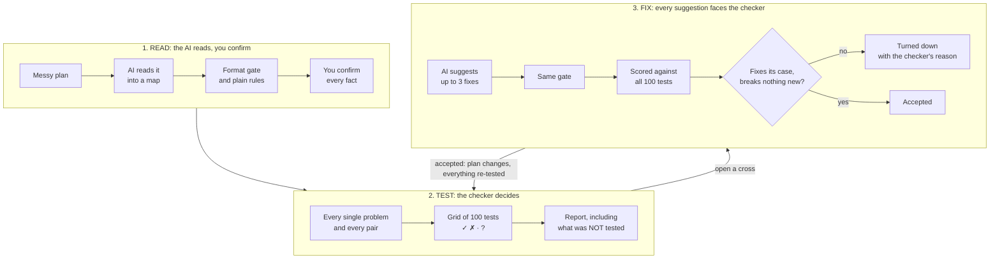
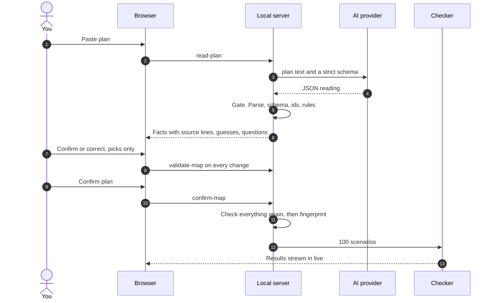
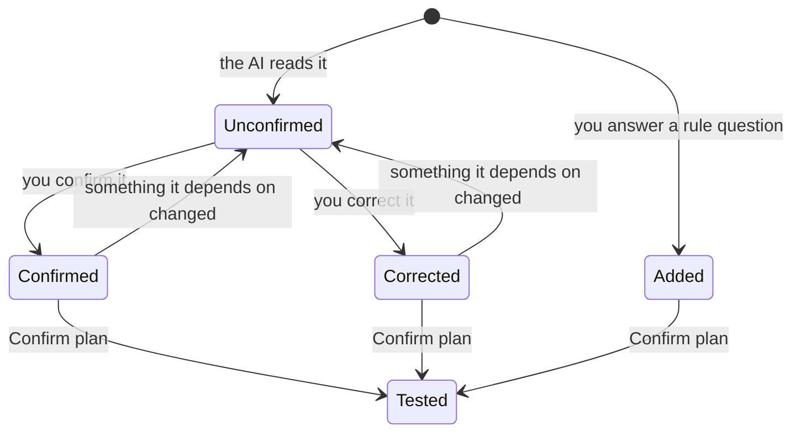
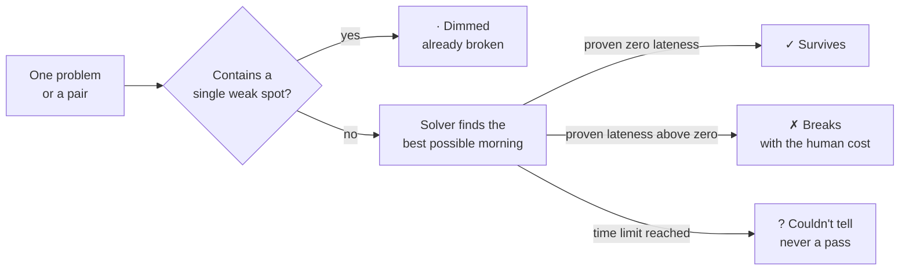
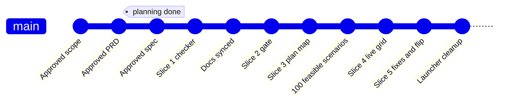

<!--
  README notes for the author (invisible on GitHub):
  - Every "REPLACE" comment marks an image, link or video you still need to add.
  - Every "VERIFY" comment marks a fact to re-check on a clean clone before submitting.
  - Every "UPDATE" comment marks a section that changes as slices land.
  - The example is locked at 100 tests; same-person pairs are skipped.
-->

> [!NOTE]
> **Submission draft.** The working app is complete through slice 5: example plan, confirmation, live checker, case details and fixes. Readings and suggestions are hand-written placeholders, clearly labelled in the app. Live AI and reports are planned for slices 6 and 7. Video, image and PDF links below are placeholders for the final submission.

<div align="center">

# Failure Compiler

**Crash-test a plan before Saturday does.**

AI reads a messy plan. A strict checker tries every single problem and every pair of problems against it.<br/>
Fixes get tested before you trust them.

[](LICENSE)
[](pyproject.toml)
[](https://developers.google.com/optimization/cp/cp_solver)
[](devpost/)
[](#run-it-in-60-seconds)

**[Watch the demo](https://youtu.be/VIDEO_ID)** &nbsp;·&nbsp; **[Run it in 60 seconds](#run-it-in-60-seconds)** &nbsp;·&nbsp; **[Read the planning docs](#built-plan-first)**

<!-- REPLACE: video-thumbnail.png = a frame of the grid mid-flip, with the title burned in. Replace every VIDEO_ID (4 places). -->
[](https://youtu.be/VIDEO_ID)

</div>

> [!TIP]
> **Judging in a hurry? Two minutes, five links.**
> 1. [The demo video](https://youtu.be/VIDEO_ID) (under 3 minutes)
> 2. [The moment that matters](#the-moment) (a GIF: the obvious fix gets turned down, the real one flips the grid)
> 3. [A real report the app produced](docs/sample-report.pdf) (PDF)
> 4. [Spot the hidden pair yourself](#can-you-spot-it) (a 60-second puzzle)
> 5. [Check every claim with one command](#check-every-claim-yourself)

---

## Every job had a backup. The plan still broke.

A volunteer coordinator is running a Saturday food distribution: **30 households, 3 routes, 5 volunteers, one van, one car, one loading area, everything delivered by noon.** Every route has a driver and a backup. On paper, the plan is all ticks.

Then the van comes back from its early pickup 30 minutes late. On its own, that's fine. Anita has to leave 90 minutes early. On its own, also fine. **Both on the same morning, and 8 households get no food.**

Nobody checks combinations like that by hand, because there are too many of them. Failure Compiler checks all of them, shows you the exact morning that breaks, and tests whether a fix really works before you trust it.

| Most tools and chatbots | Failure Compiler |
|---|---|
| A list of general risks ("have a backup driver") | The specific combination that breaks *your* plan |
| "Infeasible" or a red bar | **"Route C: 8 households not delivered"**, with the morning drawn out |
| Fixes that sound right | Fixes scored against every scenario; the ones that fail are **turned down** |
| A confident answer either way | Three honest answers: *breaks*, *survived what we tested*, or *couldn't tell* |

---

## Can you spot it?

Here is the plan, written the way coordinators actually write plans. **Before you open the answer:** which two things going wrong would leave families without food?

```text
SAT FOOD RUN - plan for this weekend (pls read!!)

Hall opens 9am. Loading bay needs the hall key - Joel has the only key. Joel is here 9 till 10:30, then he has to go.
Supply truck drops at the bay at 9.
Van is out on the early bread pickup, back by 9:30. Car is free from 9.
Everything delivered by 12 noon latest, families are waiting.

Route A - 10 households - car - Ravi driving, about an hour. Backup: Maya, then Joel
Route B - 12 households - van, first run - Sam driving, about 35 min. Backup: Anita or Ravi
Route C - 8 households - van, second run once it's back - Anita driving, about an hour. Backup: Sam or Ravi

Loading takes about 10 min per vehicle, only one vehicle in the bay at a time.
Loading team: Joel, Anita, Maya. Ravi can load his own car. Sam is just driving, not on loading.

Times: Ravi around till 1. Anita and Sam till 12. Maya has to leave at 10:45.
Everyone can drive.
```

<details>
<summary><b>Show the answer</b> &nbsp;(the checker found 4 ways this plan breaks)</summary>
<br/>

| What goes wrong | What happens |
|---|---|
| **Joel doesn't show up** | **Routes A, B, C: 30 households not delivered.** Joel has the only key, so nobody can open the loading area. *This is the obvious one.* |
| **Supply truck 45 min late** + **Ravi doesn't show up** | **Route A: 10 households not delivered.** Loading can't start until 9:45, and Ravi's backups both leave before an hour-long route could finish: Joel at 10:30, Maya at 10:45. |
| **Van back 30 min late** + **Anita leaves 90 min early** | **Route C: 8 households not delivered.** The van finishes Route B at 10:45. Joel and Anita left at 10:30, and Maya leaves at 10:45. Nobody on Route C's loading list is left to load it. |
| **Van back 30 min late** + **Anita doesn't show up** | Same as above. If leaving early breaks the plan, not coming at all has to break it too. |

Every problem in the last three rows is **harmless on its own**. Each one only breaks the plan when it's paired with another. That's a **hidden pair**, and it's what this tool exists to find.

</details>

---

## How it works



> [!IMPORTANT]
> **The one rule:** AI reads the plan and suggests fixes. The checker decides. AI never has the final word on whether a plan passes or fails.

1. **Paste a plan.** Or load the example. No AI key is needed for the example.
2. **Check the map.** The AI turns the text into plain statements like *"Maya leaves at 10:45"*, each linked to the line of your plan it came from. Guesses are flagged, and anything unclear becomes a question. You confirm or correct each fact, picking from names and times already in the plan; there's no free typing.
3. **Crash-test it.** The checker tries every single problem and every pair from a fixed list. The grid fills in live.
4. **Open a cross.** See the two problems, proof that each one alone was fine, the morning drawn on a timeline, and the human cost in households.
5. **Fix it.** Up to 3 suggested fixes, each already scored against all 100 tests. The ones that don't work are turned down, with the checker's reason. Accept one and every test re-runs.
6. **Report (planned for slice 7).** What was tested, what broke, what fixed it, and what was **not** tested. Print it or save it as a PDF.

---

## What you see

<!-- REPLACE all six images with full-page screenshots at 1440x900 from the final build. -->
<table>
<tr>
<td width="50%"><br/><b>1. Paste the plan.</b> A sheet of paper, not a form.</td>
<td width="50%"><br/><b>2. The plan map.</b> Hover a fact and its source line lights up on the left.</td>
</tr>
<tr>
<td><br/><b>3. The crash test.</b> 100 tests, one triangle, filling in live.</td>
<td><br/><b>4. The broken morning.</b> Each problem alone survives; together, Route C never leaves.</td>
</tr>
<tr>
<td><br/><b>5. Turned down.</b> The obvious fix, rejected by the checker, with its reason.</td>
<td><br/><b>6. The report.</b> Including an honest "What was NOT tested" section.</td>
</tr>
</table>

### The moment

<!-- REPLACE: a 6 to 10 second GIF. Preview the turned-down fix, cancel, accept "Sam loads Route C", crosses flip to ticks. Under 10 MB. ScreenToGif works on Windows. -->
<p align="center"></p>

---

## The example, in numbers

> **100 tests: 1 single weak spot, 3 hidden pairs, 12 already broken by the weak spot, 84 survived.**

The checker turns a fixed list of problem types into concrete problems for the people, vehicles and places in your plan:

| Problem type | Applies to | Size tested | In the example |
|---|---|---|---|
| Doesn't show up | each volunteer | the whole morning | 5 |
| Leaves early | each volunteer | 90 minutes early | 5 |
| Comes back late | each vehicle | 30 minutes late | 2 (van, car) |
| Arrives late | each supply delivery | 45 minutes late | 1 (truck) |
| Blocked | each loading area | 30 minutes from opening | 1 |
| | | **Problems** | **14** |

Every single problem (14) plus every pair (86) gives **100 tests**. There are 91 possible pairs, but 5 can't happen, such as "Anita doesn't show up" plus "Anita leaves early", so they're skipped. You can change any size before testing, but only to a preset value (15, 30, 45, 60 or 90 minutes). This version supports plans with up to 24 problems.

<details>
<summary><b>See all 100 results</b> &nbsp;(the same triangle the app draws, generated from the checker's real output)</summary>
<br/>

`✓` survives &nbsp; `✗` breaks &nbsp; `·` already broken by "Joel absent" alone &nbsp; `/` can't happen (same person twice). The diagonal holds the single problems; every cell below it is a pair.

| # | Problem | 1 | 2 | 3 | 4 | 5 | 6 | 7 | 8 | 9 | 10 | 11 | 12 | 13 | 14 |
|---:|---|:-:|:-:|:-:|:-:|:-:|:-:|:-:|:-:|:-:|:-:|:-:|:-:|:-:|:-:|
| 1 | Ravi absent | ✓ |   |   |   |   |   |   |   |   |   |   |   |   |   |
| 2 | Joel absent | · | **✗** |   |   |   |   |   |   |   |   |   |   |   |   |
| 3 | Anita absent | ✓ | · | ✓ |   |   |   |   |   |   |   |   |   |   |   |
| 4 | Maya absent | ✓ | · | ✓ | ✓ |   |   |   |   |   |   |   |   |   |   |
| 5 | Sam absent | ✓ | · | ✓ | ✓ | ✓ |   |   |   |   |   |   |   |   |   |
| 6 | Ravi leaves early | / | · | ✓ | ✓ | ✓ | ✓ |   |   |   |   |   |   |   |   |
| 7 | Joel leaves early | ✓ | / | ✓ | ✓ | ✓ | ✓ | ✓ |   |   |   |   |   |   |   |
| 8 | Anita leaves early | ✓ | · | / | ✓ | ✓ | ✓ | ✓ | ✓ |   |   |   |   |   |   |
| 9 | Maya leaves early | ✓ | · | ✓ | / | ✓ | ✓ | ✓ | ✓ | ✓ |   |   |   |   |   |
| 10 | Sam leaves early | ✓ | · | ✓ | ✓ | / | ✓ | ✓ | ✓ | ✓ | ✓ |   |   |   |   |
| 11 | Van back late | ✓ | · | **✗** | ✓ | ✓ | ✓ | ✓ | **✗** | ✓ | ✓ | ✓ |   |   |   |
| 12 | Car back late | ✓ | · | ✓ | ✓ | ✓ | ✓ | ✓ | ✓ | ✓ | ✓ | ✓ | ✓ |   |   |
| 13 | Truck late | **✗** | · | ✓ | ✓ | ✓ | ✓ | ✓ | ✓ | ✓ | ✓ | ✓ | ✓ | ✓ |   |
| 14 | Loading area blocked | ✓ | · | ✓ | ✓ | ✓ | ✓ | ✓ | ✓ | ✓ | ✓ | ✓ | ✓ | ✓ | ✓ |

Notice row 7: "Joel leaves early" survives. He's there at 9:00 to unlock the hall before he goes, and the hall stays open once it's unlocked. "Joel absent" is a different story.

</details>

---

## The broken morning

Van back 30 minutes late **and** Anita leaves 90 minutes early. Route C can only be loaded by Joel, Anita or Maya. Look at where their bars end, and when the van gets back.

```mermaid
gantt
    title Van back 30 min late and Anita leaves 90 min early
    dateFormat HH:mm
    axisFormat %H:%M
    section Van
    Early bread pickup, back 30 min late :done, v1, 09:00, 60m
    Route B, loaded by Joel, driven by Sam :v2, 10:00, 45m
    section Loaders
    Joel, the only key holder :j, 09:00, 90m
    Anita, leaves 90 min early :crit, a, 09:00, 90m
    Maya :m, 09:00, 105m
    section Route C
    Van is back. Nobody left to load. 8 households not delivered :crit, milestone, c, 10:45, 1m
    section Deadline
    Noon. Families waiting :milestone, noon, 12:00, 1m
```



**Each problem alone is fine:**
- **Van late only:** Anita is still there at 10:45 and loads Route C.
- **Anita leaving only:** the on-time van is back from Route B by 10:15, while Anita and Maya are still there to load Route C.

**Together:** the van is free at the exact moment the last loader walks out.

### Why the obvious fix fails

| Suggested fix | Checker's verdict | Why |
|---|---|---|
| Add Maya as a backup driver for Route C | **✗ Turned down.** Fixes 0. | Route C was never short of a driver. It's short of a *loader* when the van gets back, and Maya leaves at 10:45 anyway. |
| Sam loads Route C | **✓ Fixes 2** | Sam is the one bringing the van back at 10:45. Let him load it. |
| Sam backs up Route A | **✓ Fixes 1** | Someone who stays until noon can drive Route A after the late truck. |
| Give Maya a spare key | **✗ Turned down.** 1 new cross. | It fixes "Joel absent", but creates a new hidden pair: Joel **and** Maya absent leaves nobody with a key. |
| Spare keys for Maya and Sam | **✓ Fixes 1.** Breaks nothing. | Any two of the three key holders can be missing and someone still opens the hall. |

> After the three accepted fixes, in any order: **All 100 tested scenarios survive.**

```mermaid
gantt
    title The same morning with one fix. Sam loads Route C
    dateFormat HH:mm
    axisFormat %H:%M
    section Van
    Early bread pickup, back 30 min late :done, 09:00, 60m
    Route B, loaded by Maya, driven by Sam :10:00, 45m
    Route C loaded by Sam :active, 10:45, 10m
    Route C driven by Ravi :active, 10:55, 60m
    section Deadline
    Noon. Families waiting :milestone, 12:00, 1m
```

<!-- UPDATE after slice 6: in example mode these suggestions come from a saved AI run (fixtures/example-fixes.json). If the real AI suggests different fixes, update this table to match. Never present hand-written suggestions as AI output. -->
<sub>Current example mode uses hand-written PLACEHOLDER suggestions (<code>fixtures/example-fixes.json</code>). Each suggestion is gated and scored by the live checker; reopening the same case uses its cached results.</sub>



Route C is back at 11:55. That's inside the deadline by 5 minutes, and that's all the tool claims: **it survives the problems that were tested.** If you want a bigger margin, a minimum-buffer setting is on the [roadmap](#roadmap).

<details>
<summary><b>Try it yourself: change one number</b></summary>
<br/>

Predict first: **what happens if Maya stays 10 minutes longer, until 10:55?**

```bash
cp fixtures/example-truth.json my-plan.json
# In my-plan.json, change Maya's "available_until" from 645 (10:45) to 655 (10:55)
uv run -- python scripts/check_map.py my-plan.json
```

<details>
<summary>Answer</summary>
<br/>

**All three hidden pairs disappear.** Only "Joel absent" is left. Ten minutes of one volunteer's morning is the difference between 3 hidden failures and none, and no person could see that by reading the plan. At 10:50 the pairs come back.

</details>
</details>

---

## Where AI is used, and where it isn't

This is the planned live-AI flow for slice 6. The current example mode makes no AI calls.

| AI does | AI never does |
|---|---|
| Reads the messy plan into a structured map | Decide whether the plan passes or fails |
| Flags its guesses and asks about anything unclear | Choose which problems get tested |
| Writes one plain sentence explaining a break, clearly labelled | Write the reason a fix was turned down |
| Suggests up to 3 fixes, from a fixed list of allowed changes | Invent new people or vehicles |



**The gate.** Nothing the AI returns reaches the screen until it passes every step:
1. It parses as JSON.
2. It matches the schema exactly. Missing fields or extra fields are rejected ([Pydantic](https://docs.pydantic.dev/latest/), `extra="forbid"`).
3. No duplicate ids, and every reference points to something that exists.
4. Ids are rewritten to stable names (`person-ravi`, `vehicle-van`), so the same plan always gets the same fingerprint.
5. Plain rules pass: every route has a vehicle and a listed driver who can drive, the times make sense, there's a finish time, and the plan is under the size limit.
6. You confirm every fact. Guesses and questions need their own answer.
7. The server checks the whole map again on Confirm, and the checker refuses any map that fails.

Rejections name the problem, for example: *Unknown person id 'person-dave' in route-c driver_ids.* Suggested fixes go through the same gate. A fix that fails shows **Couldn't apply** and is never scored.

**Every fact has a status, and changes ripple through.**



If you correct Ravi to "can't drive", every route that lists him as a driver loses its confirmed mark and shows *Check this: Ravi changed*. The AI never re-reads your plan after you start correcting it, because a re-read could quietly change facts you already confirmed.

**The fingerprint.** A confirmed map gets a SHA-256 fingerprint of exactly what the checker uses: people, vehicles, places, deliveries, routes, finish time and problem sizes. The same plan always gets the same fingerprint. Status marks and AI details don't change it. Every result carries it; the planned report will include it too.

---

## How the checker decides

Each test is one run of [Google OR-Tools CP-SAT](https://developers.google.com/optimization/cp/cp_solver), a free, open-source constraint solver. It searches for the best possible morning, the one with the least **households × minutes late**, using only what your plan allows.



**What it models**
- A volunteer has an available-from and available-until time, and can't be in two places at once.
- A vehicle does one route at a time. It's busy from the start of loading until the route ends.
- The loading area takes one vehicle at a time. It opens at its opening time, once the supply truck is there and a key holder has arrived.
- Each route needs a listed loader present while loading, then a listed driver and its vehicle.
- **Only the people the plan names for a job can do that job.** Primary first, then listed backups. Start times can move freely within everyone's hours. That's what makes "add another backup driver" a real fix that can be tested, and turned down.
- Noon is a soft deadline, so lateness can be measured instead of just failing.

**Why "not delivered" instead of "infeasible".** Some routes can't run at all, for example when nobody can open the loading area. Those routes count as "not delivered", with a penalty bigger than any possible lateness: households × (finish time + 180 minutes). So the solver always returns an answer, and the screen can say "8 households not delivered" instead of "no solution". The checker only reports a route as *late* when something becomes free later. When nobody is left to do the job, it says *not delivered*.

**Why dimming is safe.** Every problem type only *removes* options. A pair can never do better than its worse single, so a pair that contains a single weak spot is already broken, and there's no need to solve it. A test checks this on every pair. When a fix removes the weak spot, its dimmed pairs get tested properly again, and they can reveal a hidden pair. That's how the one-spare-key fix gets caught.

**Why the results never change.** The solver uses one worker, a fixed seed (42), and a *deterministic* time limit that counts solver work instead of seconds, so a slower laptop gets the same answer. In our runs, all 100 tests finish in about a second.

---

## What it does not claim

> [!WARNING]
> **Survived means survived what was tested, not "safe".** Failure Compiler only knows what's in the confirmed map, and only tests the fixed list of problems above. It does not test:
> - three or more problems at once
> - problem types outside the list: bad weather, someone getting sick halfway through, wrong addresses, running short of food, volunteers arriving late
> - other sizes of the same problems (the truck was tested 45 minutes late, not 90)
> - anything the plan didn't mention
>
> Any "?" result is listed by name in the report and never counted as a pass. This version supports community distribution plans with up to 24 problems. It is a proof of concept, not a guarantee for real-world operations.

<!-- UPDATE after slice 6: delete this note once the placeholder reading is replaced by a real AI reading. -->
> [!NOTE]
> **Build status:** until the live-AI step is finished, example mode uses a hand-written placeholder reading, clearly labelled in the app. It gets replaced by a real, saved AI reading before submission. The checker's results above do not depend on it: they come from the hand-checked truth map.

---

## Check every claim yourself

Every number in this README can be reproduced from the repository.

<!-- UPDATE: tick the last rows as slices 5 and 6 land. VERIFY every test file name against tests/. -->
| Claim | How to check it |
|---|---|
| 1 single weak spot, 3 hidden pairs, 12 dimmed, 84 survived | `uv run -- python scripts/check_map.py fixtures/example-truth.json` |
| All 100 results are locked, human-cost wording included | [`tests/test_example_locked.py`](tests/test_example_locked.py) |
| The obvious fix fails, the real fixes pass, one spare key reveals a new pair | [`tests/test_example_fixes.py`](tests/test_example_fixes.py) |
| A pair is never better than its singles, which is why dimming is safe | [`tests/test_checker_monotone.py`](tests/test_checker_monotone.py) |
| Same map, same results, every run | [`tests/test_determinism.py`](tests/test_determinism.py) |
| Bad AI output is rejected, and the error names the field | [`tests/test_format_gate.py`](tests/test_format_gate.py) |
| Changing one fact un-confirms everything that depends on it | [`tests/test_rules.py`](tests/test_rules.py) |
| The fingerprint changes only when the checker's inputs change | [`tests/test_fingerprint.py`](tests/test_fingerprint.py) |
| The whole demo story plays end to end in a real browser | [`scripts/verify_story.py`](scripts/verify_story.py), with the dev server running and Playwright installed |
| V2 navigation, animation recovery, every sample square, editor controls and responsive layouts work | [`scripts/verify_landing.py`](scripts/verify_landing.py), at desktop, tablet and phone sizes |
| The saved AI reading plus the demo's corrections equals the hand-checked map | `tests/test_reading_matches_truth.py` *(slice 6)* |

Run the Python tests with `uv run -- python -m pytest -q`. Browser checks run separately with `uv run -- python scripts/verify_landing.py` and `uv run -- python scripts/verify_story.py`.

---

## Run it in 60 seconds

<!-- VERIFY on a clean clone before submitting: install folder for npm, and the dev.py command. -->
You need [uv](https://docs.astral.sh/uv/), which installs Python 3.12 for you, and Node.js 20 or newer.

```bash
git clone https://github.com/vighriday/failure-compiler.git
cd failure-compiler
uv sync --extra dev
npm install
uv run -- python scripts/dev.py
```

Open **http://localhost:5173** and click **Try the example plan**, then **Read plan**. Or open **Start** and click **Load the example plan**. No account and no AI key needed.

The interface follows the supplied Landing v2 design: Overview, a scroll-linked Plan story, Read, Crash test, Trust and Start. Sample illustrations are labelled; after loading a plan, Read and Crash test use the real confirmation and checker flow. The design templates and conversion instructions are in [`design/landing-v2/`](design/landing-v2/).

**Live AI is planned for slice 6.** The current build supports the example plan and does not load `.env` or use the key field yet. You can prepare `.env` from `.env.example` with a [Groq](https://console.groq.com/keys) key in `GROQ_API_KEY` and a [Gemini](https://aistudio.google.com/apikey) key in `GEMINI_API_KEY`; these will become usable when the provider integration is connected.

| Task | Command |
|---|---|
| Run the app | `uv run -- python scripts/dev.py` |
| Run all tests | `uv run -- python -m pytest -q` |
| Print the results for any map file | `uv run -- python scripts/check_map.py fixtures/example-truth.json` |
| Lint | `uv run -- ruff check .` |
| Compare the two AI providers on the example | `uv run -- python scripts/bakeoff.py` *(slice 6)* |

Playwright is a development dependency. Install its browser once with `uv run -- python -m playwright install chromium`. Start the app, then run either browser check. For a different frontend port, set `FAILURE_COMPILER_URL` to that local URL before running the scripts.

---

## Built plan-first

This project was built with the **[Devpost Learn Skill Pack](https://github.com/challengepost/learn-ai-basics)** for [Build With AI: Basics](https://learn-ai-basics.devpost.com/). Every planning document the skills produced is in [`devpost/`](devpost/), next to an HTML version with diagrams.

| Skill | What it does | What it produced here |
|---|---|---|
| `1-start` | Learns the idea, your experience and your learning goal | A private learner profile (kept out of the repo) |
| `2-scope` | Finds the kernel, defines "done", cuts the idea down | [`scope.md`](devpost/scope.md) · [visual](devpost/scope.html) |
| `3-prd` | Screens, behaviour, edge cases, look and feel. No code talk. | [`prd.md`](devpost/prd.md) · [visual](devpost/prd.html) |
| `4-spec` | Stack, data, components, risks | [`spec.md`](devpost/spec.md) · [visual](devpost/spec.html) |
| `5-build` | Small working slices, each tested and committed | [`checklist.md`](devpost/checklist.md); the app map is planned for the learning wrap-up |
| `6-ship` | Repo, video, submission | Planned after the build and review are complete |

**Every plan was approved and committed before any code.** Run `git log --oneline --reverse` to see the trail:

<!-- UPDATE: add a commit line for each slice as it lands. -->


**What planning caught before it became code:**

| Caught at | What was wrong | What would have shipped |
|---|---|---|
| Scope review | One weak spot would fill a whole row and column of the grid with crosses | A wall of red hiding the hidden pairs. Fixed with the dimmed mark. |
| PRD interview | "How late is late" was read as a tolerance on the deadline | A meaningless setting. It means the size of each problem. |
| PRD review | The grid showed every pair twice | Wrong counts on the main visual. Fixed with one triangle. |
| Spec review | The AI's schema included fields only the server should own | An AI forced to invent a fingerprint and a fix history |
| Spec review | No rule for who may do which job | "Add a backup driver" could never be tested or turned down |
| Spec review | No key holder meant "no solution", not a number | The main weak spot with no human cost. Fixed with "not delivered". |
| Build checklist | "Give the key to another person" | A fix that just moves the weak spot. Now: spare keys. |
| **Slice 1 tests** | **The demo story designed by hand was mathematically impossible** | **A demo whose numbers could not be true** |

That last one is the project's own idea, turned on itself: a plan that looked right was tested, and it broke. Every problem type only removes options, so if "van late + Anita leaves early" breaks the plan, "van late + Anita absent" has to break it too. The original target of two hidden pairs could never come true, and the tests proved it before any screen existed.

### Build progress

<!-- UPDATE as slices land. -->
- [x] **Slice 1:** the checker proves the example's story (no screens, no AI)
- [x] **Slice 2:** the gate rejects bad AI output; rules catch broken maps
- [x] **Slice 3:** the plan map screen
- [x] **Slice 4:** the grid fills live
- [x] **Slice 5:** broken case, fixes, flip
- [ ] **Slice 6:** live AI with Groq and Gemini, and a real saved reading
- [ ] **Slice 7:** report, before and after, design pass
- [ ] Final review, learning wrap-up and app map

<!-- Keep this paragraph truthful. Edit the wording however you like. -->
**How it was built.** The skills ran across several coding agents. Each switch happened when a usage limit ran out, and nothing was lost because the `devpost/` files and git carry the state. I also used Claude in a separate chat as a reviewer, to stress-test my answers and check each draft before approving it.

---

## Architecture

<details>
<summary><b>Repository map</b></summary>
<br/>

<!-- VERIFY against the final tree. -->
```text
failure-compiler/
├── server/
│   ├── main.py              FastAPI app and API routes
│   ├── models.py            Checker, scenario and fix data shapes
│   ├── grid.py              Live result stream and counts
│   ├── fixes.py             Gate, score and apply example fixes
│   ├── session.py           In-memory maps and results by fingerprint
│   ├── config.py            Model names, problem types, size presets, limits
│   ├── ai/                  Planned: provider adapters and prompts (slice 6)
│   ├── validation/
│   │   ├── gate.py          Parse, schema, ids, normalisation
│   │   ├── models.py        AI reading and confirmed map metadata
│   │   ├── fingerprint.py   Stable hash of checker inputs
│   │   └── rules.py         The plain rules, in one place only
│   └── checker/
│       ├── scenarios.py     Singles and pairs from the problem list
│       ├── solver.py        One CP-SAT run per scenario
│       ├── runner.py        Singles first, dimming, streaming
│       └── explain.py       Reasons from checker inputs and schedule
├── web/                     React, Vite and TypeScript (strict)
├── fixtures/
│   ├── example-plan.txt     The messy plan
│   ├── example-truth.json   The hand-checked correct map
│   ├── example-reading.json Hand-written PLACEHOLDER reading
│   ├── example-fixes.json   Hand-written PLACEHOLDER suggestions
│   └── expected-results.json  All 100 locked results
├── scripts/                 dev.py, check_map.py, verify_story.py
├── tests/                   pytest, plus a Playwright end-to-end test
└── devpost/                 scope, PRD, spec and checklist
```
</details>

<details>
<summary><b>API</b></summary>
<br/>

| Endpoint | What it does |
|---|---|
| `POST /api/read-plan` | Returns the hand-written example reading with no AI call. Live plan reading is planned for slice 6. |
| `POST /api/validate-map` | Runs the rules after every correction, so the screen updates straight away |
| `POST /api/confirm-map` | Checks everything again and returns the fingerprint |
| `GET /api/run-tests` | Streams each result as it finishes (server-sent events) |
| `POST /api/suggest-fixes` | Loads placeholder explanations and suggestions, then gates, scores and caches the fixes. Live AI is planned for slice 6. |
| `POST /api/apply-fix` | Applies an accepted fix, records the before and after fingerprints, re-tests |
| `GET /api/report` | Planned for slice 7; not implemented yet |

</details>

<details>
<summary><b>Stack, and why each piece</b></summary>
<br/>

| Piece | Choice | Why |
|---|---|---|
| Checker | [OR-Tools 9.15, CP-SAT](https://developers.google.com/optimization/cp/cp_solver) | Built for scheduling, and it can *prove* the best possible result |
| Server | [FastAPI](https://fastapi.tiangolo.com/), built-in server-sent events | Live streaming without another library |
| Data shapes and gate | [Pydantic v2](https://docs.pydantic.dev/latest/) | One strict definition of every shape |
| Python | 3.12 with [uv](https://docs.astral.sh/uv/) | Identical installs on Windows, macOS and Linux |
| AI, first choice (planned) | [Groq](https://console.groq.com/docs/structured-outputs) | Model and structured-output support will be verified in slice 6 |
| AI, fallback (planned) | [Gemini](https://ai.google.dev/gemini-api/docs/structured-output), via `google-genai` | Provider integration and fallback will be verified in slice 6 |
| Frontend | React, Vite, TypeScript (strict) | The grid, panel, preview and report share a lot of state |
| Styling | Plain CSS variables, no UI kit | A coordinator's run sheet, not a stock dashboard |
| Type | [IBM Plex Sans and Mono](https://github.com/IBM/plex), self-hosted | Mono for times and counts so the numbers line up |
| Grid and timeline | Hand-built CSS grid and SVG | Exact marks; no chart library fighting the design |
| Contract | Pydantic models and TypeScript types, currently maintained separately | [openapi-typescript](https://openapi-ts.dev/) generation is planned in the spec |
| Tests | pytest, ruff, Playwright | |

**Deliberately not used:** AI frameworks that hide retries and validation (the gate is the point), UI kits and utility CSS (the generic look), a database (nothing needs saving), and accounts.

</details>

---

## Design

The app looks like a coordinator's run sheet, not a tech dashboard: warm paper, near-black ink, IBM Plex.

- **Colour only carries meaning.** Green for survived and the main action, brick red for breaks, amber for questions and guesses, grey for dimmed. Everything else is neutral.
- **Marks, not just colour.** Ticks and crosses are drawn as pen strokes, so the grid reads for colourblind viewers too.
- **Motion only where it means something.** Cells fill in order, and accepted fixes flip cells in place. Reduced-motion settings are respected.
- **The deadline is a line, not a number.** The timeline draws noon as a solid red line labelled *Noon: families waiting*.
- **The normal is quiet; the exceptions are loud.** Confirmed facts get a small tick. Guesses, corrections and questions get the attention.

---

## Privacy and security

- Runs on your own machine. The server only listens on `127.0.0.1`.
- Example mode makes **no AI calls**.
- Planned live-AI mode will send plan text to the selected provider. The current app makes no provider requests. The example plan is fictional.
- `.env` is ignored by Git. Provider keys are not loaded or used by the current build.
- Nothing is saved. Closing the tab ends the session.

---

## Roadmap

Not in this version, by choice:
- A second example, such as setting up an event, running on the same checker
- AI-suggested problem types for a specific plan, run only after you approve them
- A minimum-buffer setting, such as "must finish 15 minutes before noon"
- Three-problem combinations, with a smarter search
- A nicer report download and a live link

---

## Why I built this

<!--
  WRITE THIS SECTION YOURSELF, in your own words. 3 to 5 sentences.
  The honest version you already have: you haven't run a food distribution yourself; you've seen plans
  that looked complete fall apart when two small things went wrong at once; you picked food
  distribution because the people who pay for a broken plan are families waiting for food.
  Add what surprised you most while building it.
-->

---

## Acknowledgements

- [Devpost Learn](https://learn-ai-basics.devpost.com/) and the [Learn Skill Pack](https://github.com/challengepost/learn-ai-basics) (MIT), which shaped how this was planned and built
- [Google OR-Tools](https://github.com/google/or-tools), [FastAPI](https://github.com/fastapi/fastapi), [Pydantic](https://github.com/pydantic/pydantic), [React](https://github.com/facebook/react), [Vite](https://github.com/vitejs/vite) and [IBM Plex](https://github.com/IBM/plex)
- The names and the plan in the example are invented.

## License

[MIT](LICENSE) © 2026 vighriday
